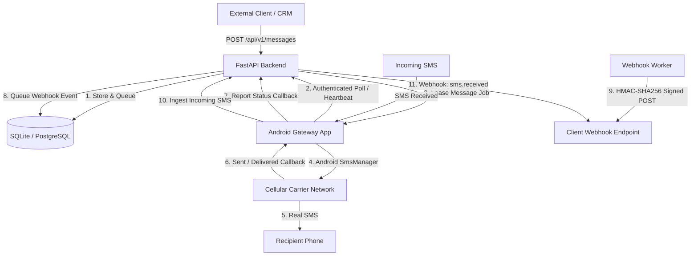

# SIM SMS Gateway Architecture

## 1. Executive Summary

**SIM SMS Gateway** transforms an Android smartphone equipped with a physical SIM card into an automated cellular SMS gateway. External systems (CRMs, websites, webhooks, alerting stacks) submit messages to a Python FastAPI backend over a secure REST API. The backend manages a persistent job queue, leases jobs to authenticated Android devices via outbound polling, and receives real-time delivery callbacks and incoming messages from the phone. All events can trigger cryptographically signed HMAC-SHA256 webhooks to subscribed consumers.



---

## 2. Monorepo Structure

```text
sim-sms-gateway/
├── android-app/             # Native Android Jetpack Compose Gateway application
│   ├── app/
│   │   ├── src/main/java/com/simsms/gateway/
│   │   │   ├── data/       # Room database, Retrofit HTTP client, SecurePreferences
│   │   │   ├── receiver/   # IncomingSmsReceiver, SmsStatusReceiver callbacks
│   │   │   ├── service/    # GatewayForegroundService (persistent connection & polling)
│   │   │   └── ui/         # 15 Jetpack Compose screens, MVVM, theme, navigation
│   │   └── src/test/java/  # Unit tests with FakeSmsTransport and deduplication tests
│   ├── build.gradle.kts
│   └── settings.gradle.kts
├── backend/                 # Python 3.12+ FastAPI backend service
│   ├── alembic/             # Database migrations
│   ├── app/
│   │   ├── api/v1/          # REST API routers (messages, devices, incoming, webhooks)
│   │   ├── core/            # Config, database engine, security, logging
│   │   ├── models/          # SQLAlchemy 2.0 ORM entities
│   │   ├── schemas/         # Pydantic v2 validation models
│   │   ├── services/        # Message, device, incoming, and webhook business logic
│   │   ├── workers/         # Background webhook delivery and timeout worker
│   │   ├── cli.py           # Administrative CLI tool
│   │   └── main.py          # Application entrypoint & middleware
│   ├── tests/               # Comprehensive pytest suite (21 unit/integration tests)
│   ├── pyproject.toml
│   ├── Dockerfile
│   └── .env.example
├── docs/                    # Technical documentation
│   ├── ARCHITECTURE.md
│   ├── API.md
│   ├── ANDROID_SETUP.md
│   ├── WEBHOOKS.md
│   ├── SECURITY.md
│   └── DEPLOYMENT.md
├── docker-compose.yml       # Production Docker deployment
└── README.md
```

---

## 3. Core Data Flow & Lifecycle

### Outgoing SMS Lifecycle
1. **Creation**: Client calls `POST /api/v1/messages` with destination number (`+255...`), message text, optional `client_reference`, and optional idempotency key.
2. **Validation**: Backend normalizes destination to strict E.164, computes GSM 7-bit parts (single part $\le 160$, multipart in 153-char chunks), and inserts a record with status `queued`.
3. **Event & Webhook**: `sms.queued` event is stored in `message_events` and queued for webhook delivery.
4. **Job Leasing**: Android phone calls `GET /api/v1/devices/jobs/next`. Backend finds the oldest unassigned `queued` message, sets `leased_device_id`, generates a unique `lease_token`, sets `lease_expires_at = now() + 60s`, and updates status to `dispatched`.
5. **Cellular Dispatch**: Phone receives the job, invokes `SmsManager.sendTextMessage()` or `SmsManager.sendMultipartTextMessage()` with unique `PendingIntent` callbacks.
6. **Transmission Callback**:
   - `SENT` callback: Phone receives `Activity.RESULT_OK` (or failure code).
   - Phone reports result to `POST /api/v1/devices/jobs/{id}/result`. Status transitions to `sent` or `failed`.
7. **Delivery Report**:
   - Carrier provides an SMS delivery report (`DELIVERED` action).
   - Phone reports `delivered` to the backend. Status transitions to `delivered`.
8. **Webhook Emission**: Each transition triggers signed webhooks (`sms.sent`, `sms.delivered`, or `sms.failed`).

### Incoming SMS Lifecycle
1. **Broadcast Reception**: Android OS broadcasts `android.provider.Telephony.SMS_RECEIVED`.
2. **Parsing & Reassembly**: `IncomingSmsReceiver` parses `SmsMessage` PDUs and reassembles multipart segments.
3. **Deduplication**: Calculates a SHA-256 hash over `sender:body:quantized_timestamp` to prevent duplicate broadcast processing.
4. **Local Persistence**: Stores incoming message in local Room database.
5. **Backend Sync**: Dispatches `POST /api/v1/incoming/report` with the message data.
6. **Webhook Emission**: Backend ingests the message idempotently and emits `sms.received` webhook.

---

## 4. Device Connectivity Model

Phones connected via cellular data are typically behind Carrier-Grade NAT (CGNAT) without public IP addresses. 

To ensure reliable communication without requiring port forwarding:
- **Outbound Authenticated HTTPS Polling**: The Android phone initiates all network connections.
- **Persistent Heartbeats**: Phone sends periodic heartbeats to `POST /api/v1/devices/heartbeat` with battery percentage, signal strength, and network type.
- **Online/Offline Tracking**: Devices not seen within 90 seconds are automatically marked `offline` by the backend background worker, emitting `device.offline` webhooks.
- **Lease Expiration**: If a phone crashes or loses connectivity after leasing a message, the lease expires after 60 seconds. The background worker resets the message status back to `queued` for reprocessing.

---

## 5. Security & Isolation

- **Separation of Privileges**: External API clients use API Keys (`Bearer gw_...`). Android phones use device-scoped tokens (`Bearer dt_...`). Phones cannot read other devices' data or create API keys.
- **Android Keystore**: Device tokens and server credentials on the phone are encrypted with AES-256-GCM via `EncryptedSharedPreferences` backed by hardware-backed Android Keystore.
- **SSRF Prevention**: Webhook destinations are validated against RFC 1918 private subnets, loopback addresses (`127.0.0.0/8`), link-local (`169.254.0.0/16`), and AWS/GCP cloud metadata IPs (`169.254.169.254`).
- **HMAC Signatures**: Every outgoing webhook request includes `X-Gateway-Signature: sha256=<hex>` generated with the consumer's secret over the raw request payload.
